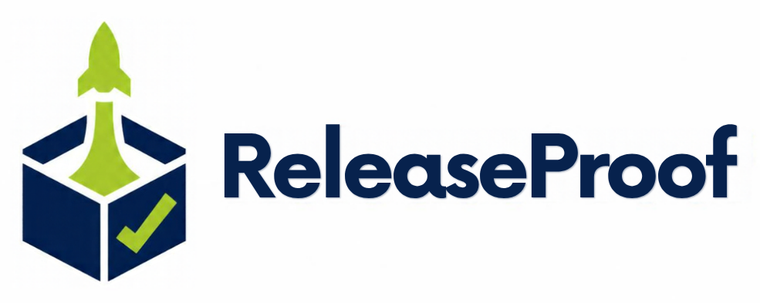

<p align="center">
  
</p>

# ReleaseProof

Build a release ZIP, inspect it safely and smoke-test it in a temporary folder before you publish it.

"It works on my machine" is not a release check. ReleaseProof builds a source ZIP that leaves out secrets and local state, validates any archive for the tricks that make unpacking dangerous, checks that the files you expect are really inside, and (only when you allow it) runs your smoke commands from a throwaway copy. It uses only the Python standard library and makes no network requests of its own.

## Install

Requires Python 3.10 or newer.

```bash
pip install git+https://github.com/seun-john/releaseproof.git
```

## Use

```bash
releaseproof build spec.json --root . --archive dist-check/app-0.1.0.zip -o report.json --strict
releaseproof inspect spec.json --root . -o report.json     # an existing archive; runs nothing
releaseproof test spec.json --root . --allow-execution     # smoke-test an existing archive
```

```json
{
  "expected_files": ["app.py", {"path": "README.md", "min_bytes": 20}],
  "commands": [["{python}", "app.py"]],
  "expected_stdout": {"0": "Hello"},
  "timeout_seconds": 10,
  "exclude_paths": ["notes/*"],
  "package_subdir": ".",
  "artifact_path": "dist-check/app-0.1.0.zip"
}
```

`artifact_path` is used by `inspect` and `test`; `build` creates the archive itself.

## What each step does

**Build** copies the project's files into a new ZIP. It never overwrites an existing file, and it leaves out `.env`, `.env.*`, SQLite databases, other ZIPs and wheels, `reports/`, `.git`, virtual environments, `node_modules`, caches, `dist` and `build`, plus anything matching your `exclude_paths` (`fnmatch` patterns; `*` also crosses `/`). **Read the list of included files before you distribute the archive.** This is not secret detection.

**Inspect** refuses archives that contain traversal paths (`../`, absolute paths, drive letters, backslashes), duplicate or case-colliding names, links or special files, encrypted entries, more than 10,000 entries, or more than 100 MiB unpacked. It then checks every `expected_files` entry for existence, `min_bytes` (default 1) and an optional `sha256`.

**Test** does the same, then runs each command from a temporary copy with no shell, a minimal environment (your API keys and other variables are not passed on), a 1-60 second timeout, and logs capped at 64 KiB with emails, keys and similar values redacted. A timeout stops the whole process tree, not just the first process. `{python}` is replaced with the interpreter running ReleaseProof; `{root}` with the working folder. For a `.whl`, the wheel is installed with `pip --no-index --no-deps` into a fresh virtual environment and the commands run from an empty folder, so you test the installed package rather than the extracted source.

Commands only run when you use `test` (or `build`) **and** pass `--allow-execution`. Otherwise the report says `NOT_EXECUTED`.

`release_ready` is true only when files were expected, commands were configured and run, and every finding passed. It means "these checks passed on this computer". It is not a guarantee of correct behaviour or of compatibility with other systems.

| Finding | Meaning |
| --- | --- |
| `BUILT`, `PASS` | The step succeeded. |
| `FAIL`, `TIMEOUT` | A file check, command or output assertion failed, or a command ran out of time. |
| `NOT_EXECUTED`, `NO_SMOKE_TESTS`, `NO_EXPECTATIONS` | Nothing was run or required, so the release cannot be called ready. |

All commands take `-o report.json`, `--html report.html` and `--strict` (exit 1 on anything other than `PASS` or `BUILT`). Exit codes: 0 completed, 1 strict findings, 2 unusable input or an unsafe archive.

## Limits

- **A temporary folder is not a sandbox.** Package code can read anything your account can read and can use the network. Only run `test` on archives you trust.
- Only source ZIPs are built. Wheels can be tested but not built here.
- Tests run on the current computer and Python version only.
- Wheel testing needs `venv` and `ensurepip`. Some minimal Linux Pythons need their `python3-venv` package.

## Develop

```bash
pip install -e ".[dev]"
ruff check . && ruff format --check . && pytest -q
```

MIT licence.


## Research paper

This tool was evaluated, with and without each tool, in an open preprint: Oluwawalemi, O. J. (2026). Do Verification Tools Improve on an AI Reader? A With-and-Without Evaluation of Fifteen Open-Source Tools for AI-Assisted Research. Zenodo. https://doi.org/10.5281/zenodo.23404947

The test corpora, truth labels, verdicts and scripts are in the same Zenodo record. Independent replication and testing are welcome. Please open an issue to share results.
